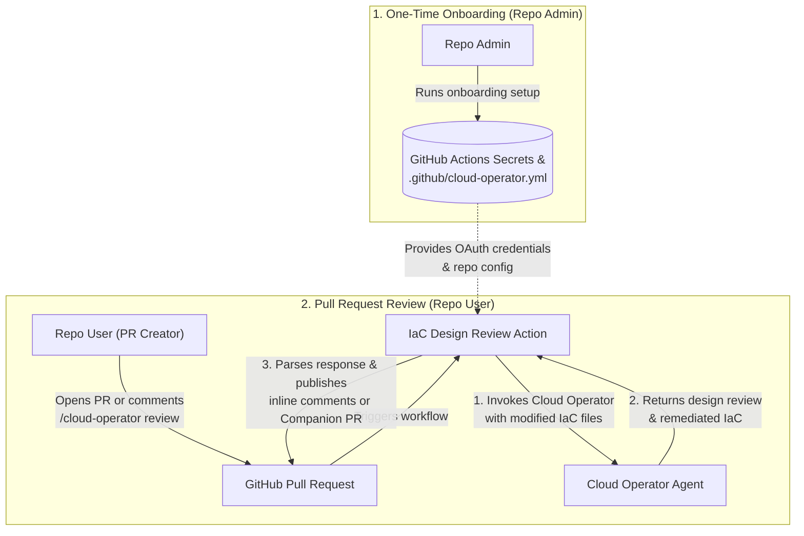

# AutoCloud Operator — GitHub Integration (`actions/iac_design_review`)

Self-contained GitHub Action (`iac_design_review/runner_main.py`, `action.yml`)
and onboarding CLI wizard (`iac_design_review/cli_init.py`) for connecting a
GitHub repository to the **AutoCloud Operator** agent via MCP
(`ask_cloud_operator`).

## Architecture Overview

1. **Onboarding (`iac_design_review/cli_init.py` / `autocloud-github-init`)**:
   - **Zero-Clone Remote Mode (`--github_repo=owner/repo`)** or **Interactive
     Wizard (`--interactive=true`)**:
     1. Validates local Google ADC credentials (`~/.config/gcloud/application_default_credentials.json`)
        or automatically invokes `gcloud auth application-default login`.
     2. Uploads `AUTOCLOUD_OAUTH_CONFIG` to the repository's GitHub Actions
        Secrets (`gh secret set`).
     3. Automatically enables *"Allow GitHub Actions to create and approve pull
        requests"* on the target repository (`PUT /repos/{owner}/{repo}/actions/permissions/workflow`).
     4. Commits `.github/autocloud.yml` and `.github/workflows/autocloud.yml`
        directly to the remote repository via the GitHub Contents API.
   - **Local Directory Mode (`--repo_dir=/path/to/repo`)**:
     - Writes `.github/autocloud.yml` and `.github/workflows/autocloud.yml` to a
       local checkout.
   - Note: **Scenario 2 (Issue & Bug Implementation)** is currently marked as
     **Work in Progress (not available yet)**.
2. **Runtime Execution (`iac_design_review/runner_main.py`)**:
   - Exchanges the stored OAuth 2.0 `refresh_token` against
     `https://oauth2.googleapis.com/token` for a short-lived human EUC Bearer
     token.
   - Bundles modified PR text files into `ask_cloud_operator` over HTTPS/SSE
     (`https://geminicloudassist.googleapis.com/mcp`).
   - Delivers review feedback according to `scenarios.code_changes.pr_mode`:
     - **`inline_comments` (Default)**: Posts a GitHub Pull Request Review on
       the existing PR (`POST /repos/{owner}/{repo}/pulls/{pr}/reviews`) with
       line-anchored inline comments and one-click ````suggestion` blocks
       without opening a separate PR.
     - **`companion_pr`**: Writes remediated files inside the workspace with
       path-traversal guards, pushes `autocloud/remediate-pr-<N>`, and opens/
       updates a Companion PR targeting the contributor's PR `head` branch.
     - **`comment_only`**: Posts a top-level summary comment on the existing PR.



## Quickstart: One-Command Remote Repository Onboarding

1. Authenticate with GitHub CLI and Google Cloud ADC:

   ```bash
   gh auth login
   gcloud auth application-default login
   ```

2. Install the onboarding CLI from the `actions` subdirectory:

   ```bash
   python3 -m venv /tmp/autocloud-venv
   /tmp/autocloud-venv/bin/pip install \
     "git+https://github.com/GoogleCloudPlatform/gemini-cloud-assist-mcp.git@main#subdirectory=actions"
   ```

3. Onboard your target GitHub repository in a single command (no local clone required):

   ```bash
   /tmp/autocloud-venv/bin/autocloud-github-init \
     --github_repo=<OWNER>/<REPO> \
     --project_id=<YOUR_GCP_PROJECT_ID> \
     --agent_id=<YOUR_OPERATOR_AGENT_ID>
   ```

   Or run with no flags to launch the interactive terminal wizard:

   ```bash
   /tmp/autocloud-venv/bin/autocloud-github-init
   ```


